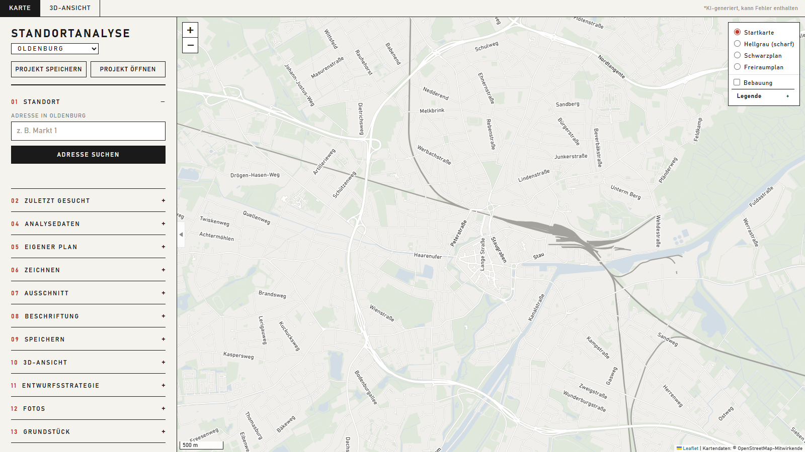
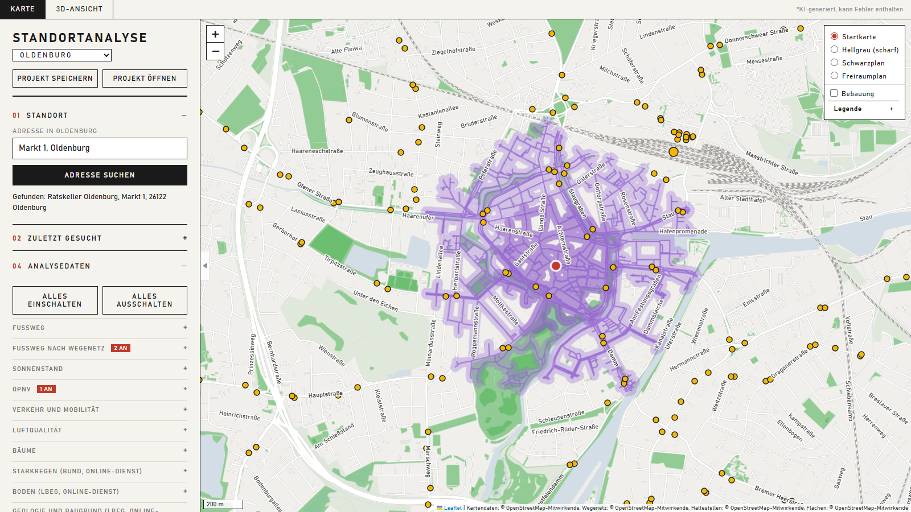

# Grundstuecksanalyse-Tool

**Eine Web-App, die für eine Adresse in Oldenburg, Osnabrück, Hannover oder Braunschweig eine grafisch aufbereitete Standortanalyse erstellt (Karte, Umgebungsdaten, 3D-Schatten, Grundstück) und als PNG, PDF, DXF oder SVG ausgibt.**

**[Live-Demo ausprobieren](https://jade-hs-vibecoding-wpk.github.io/Grundstuecksanalyse-Tool/)**

## Was kann die App?

- Adresssuche mit Autokorrektur, drei Hintergrundkarten plus Schwarzplan und Freiraumplan
- Über 60 zuschaltbare Analyse-Ebenen: Fußwege (Kreise und nach Wegenetz), Sonnenstand, ÖPNV mit Takt, Einrichtungen, Grün, Nutzungsarten, Verkehr, Lärm, Boden, Grundwasser, Starkregen, Bodenrichtwerte, Zensus u. a.
- Eigener Plan (JPG, PNG, PDF) auf der Karte einpassen, Fotos, Zeichnen und Messen
- Grundstücksanalyse (GRZ, GFZ, Baufeld) und Bewertung des Standorts als Orientierung
- 3D-Ansicht mit Schatten, Sonnenstunden und Sichtfeld, dazu Schnitt durch die Umgebung
- Entwurfsstrategie als Text (Word, PDF oder Textdatei für eine KI)
- Export als PNG, PDF (die Legende steht auf einer eigenen Seite), DXF und SVG; Projekte lassen sich speichern und wieder öffnen

## Benutzen

- **Online:** die Live-Demo oben öffnen.
- **Lokal:** den ganzen Ordner herunterladen und `Standortanalyse/index.html` per Doppelklick im Browser öffnen. Nichts muss installiert werden. Die Ordner `staedte/`, `pdfjs/` und `three/` müssen neben der Datei bleiben.
- Eine Kurzanleitung steht in der App (Abschnitt "Hilfe") und in `Standortanalyse/ANLEITUNG.html`.
- Die Daten lassen sich mit den Programmen in `Datenpflege/` erneuern (siehe `Datenpflege/LIESMICH.txt`). API-Schlüssel sind nirgends nötig.

## Quellen und Lizenzen

Alle Datenquellen werden in der App und im gespeicherten Bild automatisch genannt. Die Daten sind keine amtliche Auskunft; wo OpenStreetMap Lücken hat, fehlen sie auch in der App.

| Quelle | Verwendet für | Lizenz |
|---|---|---|
| [OpenStreetMap](https://www.openstreetmap.org/copyright) | Karte, Gebäude, Wege, Haltestellen, Einrichtungen, Grün, Bäume, Adresssuche | ODbL, © OpenStreetMap-Mitwirkende |
| LGLN Niedersachsen | Gebäudehöhen (LoD2), Gelände (DGM1), Liegenschaftskarte und Grundstücke (ALKIS) | CC BY 4.0 |
| LGLN / Gutachterausschuss (BORIS) | Bodenrichtwerte | Datenlizenz Deutschland – Namensnennung 2.0 |
| Stadt Oldenburg, Stadt Osnabrück (Open Data) | Lärm, Bebauungspläne, Schutzgebiete, Stadtbezirke | Datenlizenz Deutschland – Namensnennung 2.0 |
| PlanDigital Niedersachsen | Flächennutzungspläne | Datenlizenz Deutschland – Zero 2.0 |
| NLWKN | Schutzgebiete (Hannover, Osnabrück, Braunschweig) | Datenlizenz Deutschland – Namensnennung 2.0 (laut NLWKN-Open-Data-Seite und Metadaten der Naturschutzgebiete; für Landschaftsschutzgebiete und Naturdenkmale keine eigene Angabe gefunden) |
| LBEG (NIBIS-Kartenserver) | Boden, Geologie, Grundwasser, Versiegelung (Online-Karten) | Eigene Nutzungsbedingungen des LBEG: kostenfrei, einfaches nicht übertragbares Nutzungsrecht, Quellenvermerk Pflicht; **für eine kommerzielle Veröffentlichung der Karten ist eine Genehmigung nötig** |
| BKG | Hinweiskarte Starkregen (Online-Karte) | Datenlizenz Deutschland – Namensnennung 2.0 |
| Statistische Ämter des Bundes und der Länder | Zensus 2022 | Datenlizenz Deutschland – Namensnennung 2.0 |
| Bundesnetzagentur | Ladesäulenregister | CC BY 4.0 |
| gtfs.de / DELFI e. V. | Fahrplan (Takt der Haltestellen) | CC BY 4.0 (laut Katalogeintrag von gtfs.de, Namensnennung "gtfs.de") |
| Umweltbundesamt | Luftmessstationen | Datenlizenz Deutschland – Namensnennung 2.0 (laut GDI-DE-Metadaten), Quellenangabe "Umweltbundesamt mit Daten der Messnetze der Länder und des Bundes" |

**Nur nichtkommerzielle Nutzung:** Die Online-Karten des LBEG (Boden, Geologie, Grundwasser, Versiegelung) dürfen nur nichtkommerziell veröffentlicht werden, für eine kommerzielle Nutzung ist eine Genehmigung des LBEG nötig. Diese Anwendung ist deshalb nicht für die kommerzielle Nutzung bestimmt. Der Hinweis steht auch in der App.

Bibliotheken: [Leaflet](https://leafletjs.com) (BSD-2-Clause), [pdf.js](https://mozilla.github.io/pdf.js/) (Apache 2.0), [three.js](https://threejs.org) (MIT).

Der Programmcode steht unter der MIT-Lizenz (siehe `LICENSE`).

## Hinweis zur KI-Nutzung

- Die App wurde von **Claude** (Anthropic) in Claude Code geschrieben und getestet. Auftraggeber ist ein Architekturstudent ohne Programmierkenntnisse; Anforderungen, Entscheidungen und Abnahme kamen vom Menschen.
- In der App steht dauerhaft der Hinweis "KI-generiert, kann Fehler enthalten". Ergebnisse bitte selbst prüfen.
- Bewertung mit Schulnoten, Potenzial der Grundstücke und Schwellenwerte sind eigene Festlegungen und nicht wissenschaftlich abgesichert. Sie sind eine Orientierung, keine Rechtsauskunft und keine Wertermittlung.
- Die Entwurfsstrategie erzeugt einen Text, den man in eine KI-Anwendung kopieren kann; die App selbst ruft keine KI auf und sendet keine Daten an eine KI.
- Die Screenshots in `docs/screenshots/` zeigen die Live-Demo.
